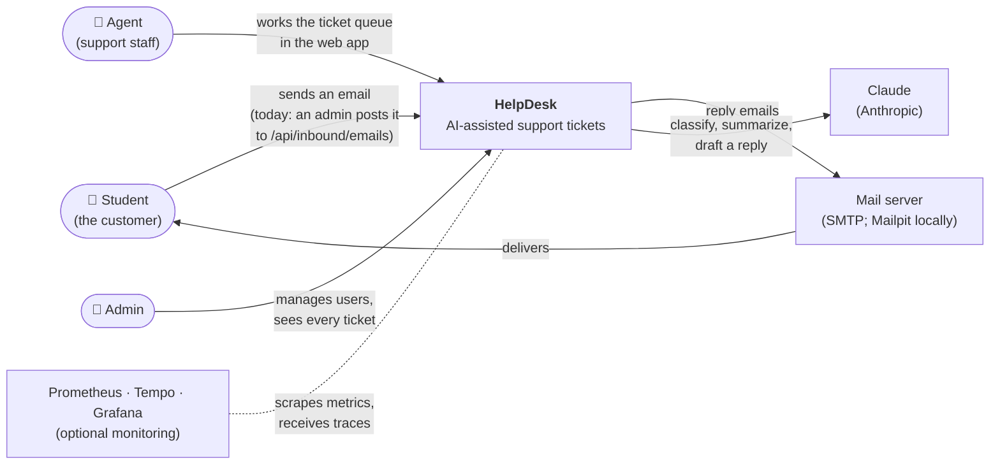
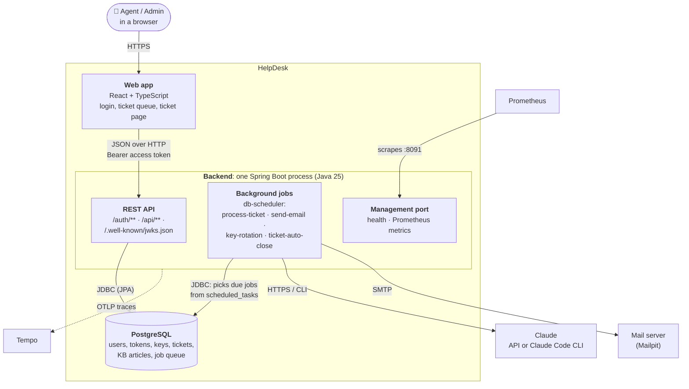

# 1. System context and containers

[← All diagrams](../README.md) · Next: [2. Deployment →](../02-deployment/README.md)

## 1a. Context: who uses HelpDesk, and what it talks to

The whole system is one box here. Around it: the people who use it and the outside systems it depends on.

What to notice:
- **Students never log in.** They only send and receive email. Only agents and admins have accounts.
- **Incoming email is simulated.** There's no mail-provider webhook yet; an admin posts the email to `POST /api/inbound/emails`, and `InboundEmailService` treats it exactly as a webhook would.
- **Claude is optional.** With AI off, every ticket simply goes to the agents.

## 1b. Containers: the running parts inside HelpDesk

Now open the HelpDesk box. A "container" here means a separately running program or data store (not necessarily a Docker container).

What to notice:
- **One backend process does everything:** it answers HTTP requests *and* runs the background jobs. They share the database.
- **The database is also the job queue.** Background work (AI processing, sending email) is a row in the `scheduled_tasks` table, so it survives restarts and runs once even with several app instances.
- **The web app holds no data of its own.** Everything it shows comes from `/api`. In production the React files are built into the Spring Boot image and served by the same process.
- **The management port is separate** and never published to the internet; only Prometheus on the private network reaches it.
