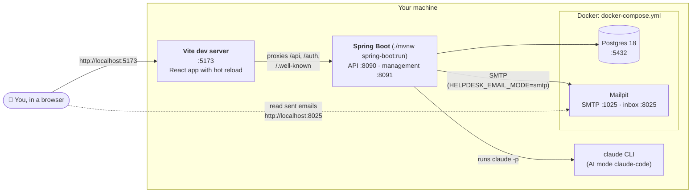
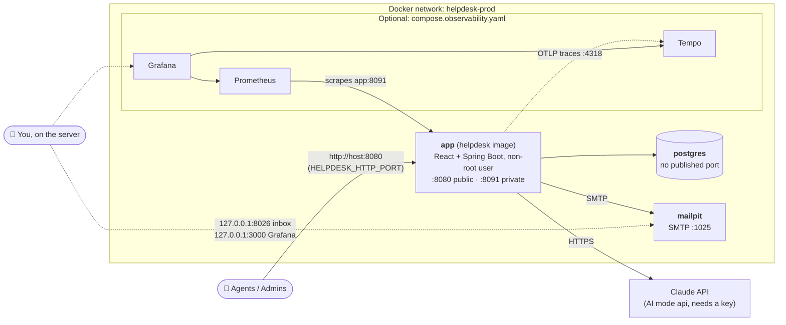
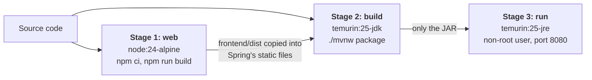

# 2. Deployment: where each part runs

[← 1. System context](../01-system-context/README.md) · [All diagrams](../README.md) · Next: [3. Data model →](../03-data-model/README.md)

The same code runs in two setups. Learn the dev one first: it's what you'll run.

## 2a. Development (your machine)

The backend and the web app run directly on your machine; Postgres and Mailpit run in Docker (`docker-compose.yml`).

- **Why the Vite proxy?** The browser sees one origin (`localhost:5173`) for both the pages and the API. That's needed for the `SameSite=Strict` refresh-token cookie.
- **AI locally** runs through the Claude Code CLI on your Pro plan, so there is no API bill.
- **Email** defaults to `log` mode (printed, not sent). Set `HELPDESK_EMAIL_MODE=smtp` to send to Mailpit.

## 2b. Production-style stack (`compose.prod.yaml`)

Everything runs in Docker on one private network. Only the app's HTTP port is published.

| Port | Published? | Why |
|---|---|---|
| app 8080 | Yes | The only public entry point: web app and API. |
| app 8091 | **No** | Health and metrics. Only Prometheus, inside the network. |
| postgres 5432 | **No** | Only the app talks to the database. |
| mailpit 8026, Grafana 3000, Prometheus 9090 | Only on `127.0.0.1` | Visible from the server itself, never from the internet. |

Secrets (`DB_PASSWORD`, `HELPDESK_KEK`, `ADMIN_PASSWORD`, `ANTHROPIC_API_KEY`) come from an `.env.prod` file kept outside git. None are in the image.

## 2c. How the image is built (`Dockerfile`)

The final image has a JRE and one JAR: no Node, no Maven, no source code. That keeps it small and leaves less to attack.
