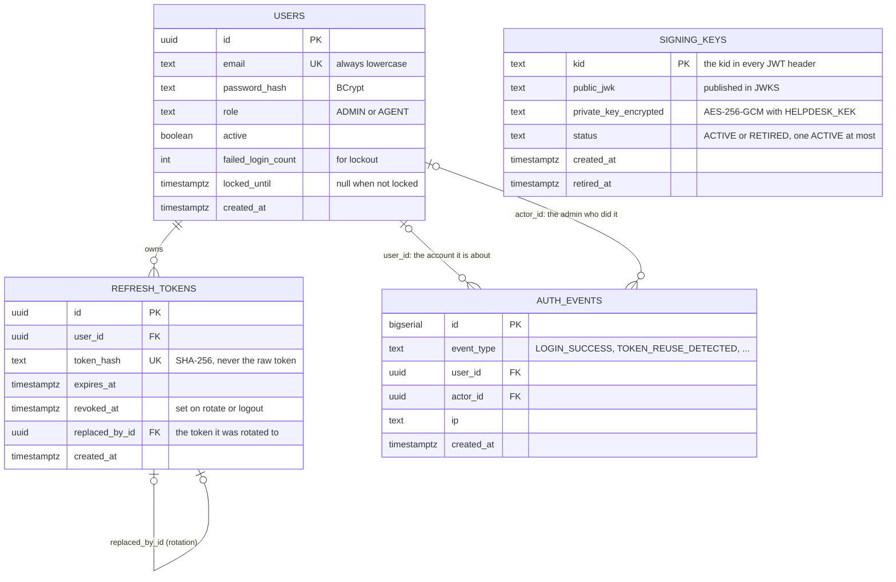
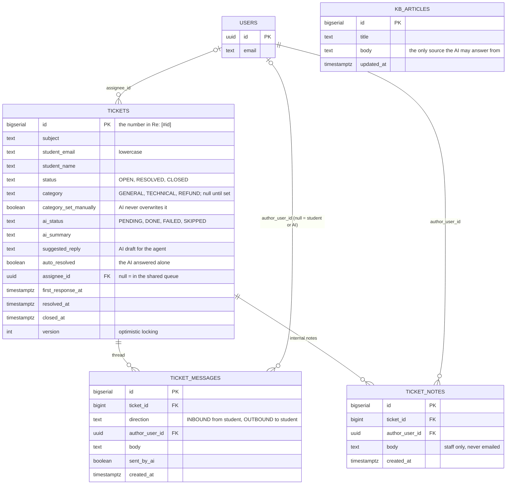
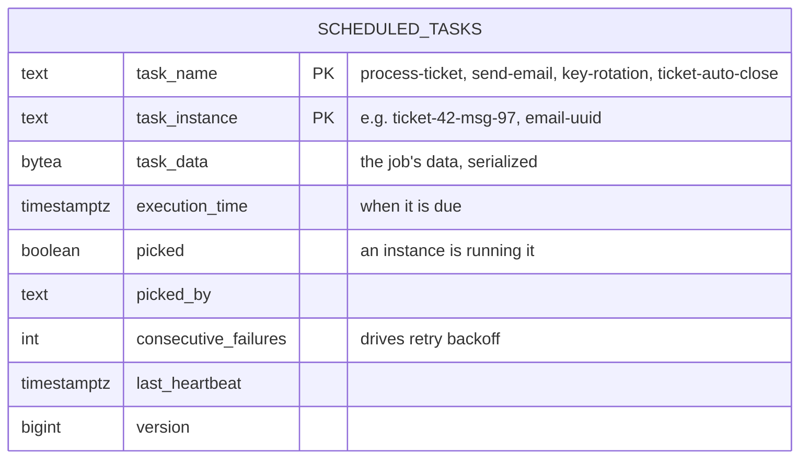

# 3. Data model (ER diagram)

[← 2. Deployment](../02-deployment/README.md) · [All diagrams](../README.md) · Next: [4. Sequence diagrams →](../04-sequence-diagrams/README.md)

Every table, from the Flyway migrations in `backend/src/main/resources/db/migration/` (`V1` to `V11`). Reading the migrations in order shows the tables arriving phase by phase.

## 3a. Accounts and security

- **No passwords or tokens in plain text.** Passwords are BCrypt hashes, refresh tokens are SHA-256 hashes, and private signing keys are encrypted with a key (`HELPDESK_KEK`) that is never stored in the database.
- **`signing_keys` stands alone.** It isn't linked to users: any user's token is signed by whichever key is ACTIVE. A partial unique index stops two keys being ACTIVE at once.
- **`auth_events` links to `users` twice:** who the event is about, and (for admin actions) who did it.

## 3b. Tickets and the knowledge base

- **Messages vs notes.** A message is part of the email conversation with the student. A note is a private comment between staff. They're separate tables so a note can never be emailed by mistake.
- **Students aren't users.** A ticket stores the student's email and name directly; only staff are rows in `users`.
- **`version`** lets two agents edit the same ticket safely: the second save fails instead of silently overwriting the first.
- **`kb_articles` isn't linked to tickets.** The AI reads all articles for every ticket and cites the ones it used.

## 3c. The job queue

This table belongs to the db-scheduler library, not to HelpDesk's own code. It's the reason background work survives a restart: a job is a row until it finishes. Section 4 shows rows being added and picked up.
