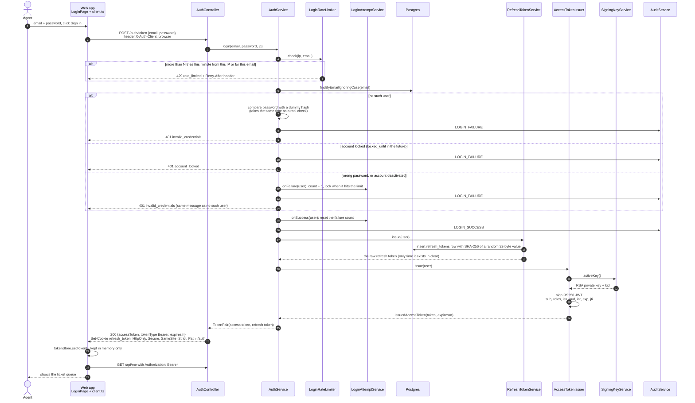

# 4.1 Login

[← Sequence list](README.md) · Next: [4.2 An authenticated API call →](02-authenticated-request.md)

An agent types their email and password into the web app. Endpoint: `POST /auth/token`.

## What to notice

- **The order of checks is deliberate** (`AuthService.login`): rate limit first (cheap, stops floods), then lockout, then the slow BCrypt password check.
- **Same answer for every failure.** Unknown email, wrong password and deactivated account all return `invalid_credentials`, and the dummy-hash comparison makes them take the same time. An attacker can't use the answer, or its speed, to find out which emails have accounts. The one exception is `account_locked`: a locked-out user needs to know why the right password is refused.
- **Two tokens, two places:**
  - The **access token** (a JWT, short-lived) goes in the JSON body. The browser keeps it in a JavaScript variable only, never in `localStorage`.
  - The **refresh token** (random, long-lived) goes in an `HttpOnly` cookie that JavaScript can't read, and that is only sent to `/auth/*`.
- **API clients are different.** Without the `X-Auth-Client: browser` header (Swagger, curl, Postman), the refresh token comes back in the JSON body instead of a cookie.
- **Every outcome is audited** in `auth_events`, without the password or tokens.
