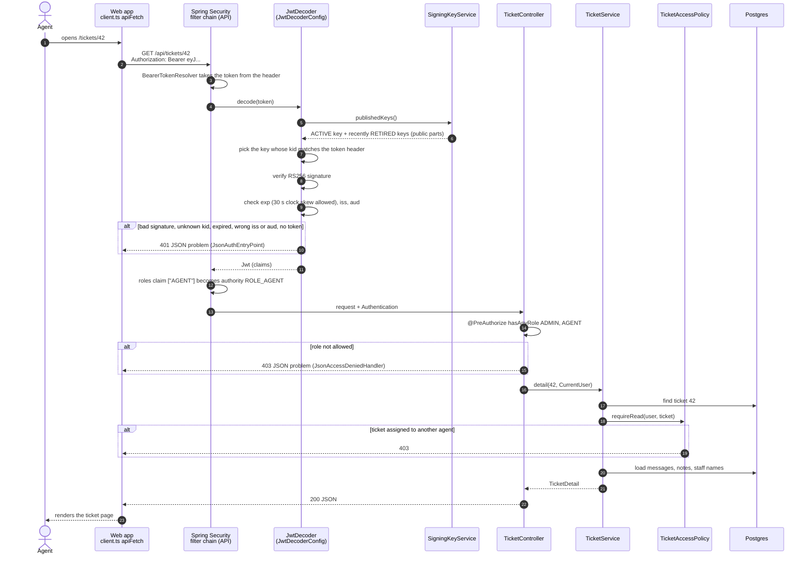

# 4.2 An authenticated API call

[← 4.1 Login](01-login.md) · [Sequence list](README.md) · Next: [4.3 Token refresh →](03-token-refresh.md)

What happens to the access token on every request. Example: an agent opens ticket 42, `GET /api/tickets/42`.

## What to notice

- **No database lookup for the user.** The token alone proves who the caller is and which role they have. That's the point of a signed JWT: the server checks a signature instead of looking up a session.
- **Keys come straight from the database,** not over HTTP from our own JWKS URL (`JwtDecoderConfig`). The same `publishedKeys()` list feeds both, so a key removed from JWKS can no longer verify anything.
- **Three layers of permission:**
  1. *Authenticated?* A valid token, checked by the filter chain.
  2. *Right role?* `@PreAuthorize` on the controller (for example, only ADMIN may assign tickets).
  3. *This particular ticket?* `TicketAccessPolicy`: an agent may read unassigned tickets and their own, and change only their own.
- **Errors are JSON** (RFC 9457 problem details), never an HTML login page, because this is an API.
