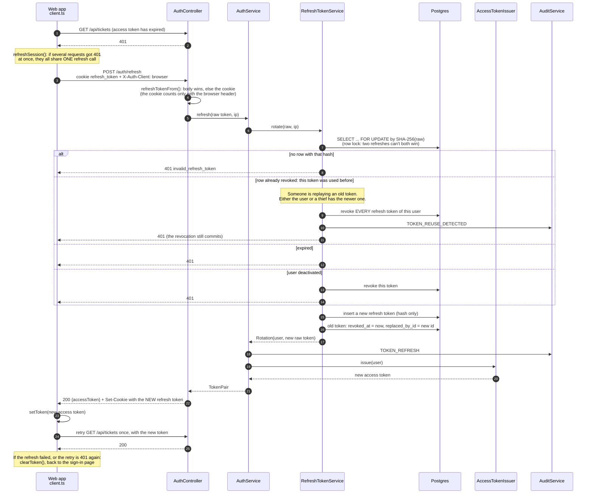

# 4.3 Token refresh and reuse detection

[← 4.2 An authenticated API call](02-authenticated-request.md) · [Sequence list](README.md) · Next: [4.4 Page reload and logout →](04-reload-and-logout.md)

Access tokens expire quickly (minutes). When one does, the web app quietly swaps the refresh cookie for a new pair of tokens and retries. Endpoint: `POST /auth/refresh`.

## What to notice

- **Rotation:** every refresh token works exactly once. Using it gives you a new one and marks the old one `revoked`, with `replaced_by_id` pointing at its successor.
- **Reuse detection:** if a revoked token is ever presented again, someone copied it. HelpDesk can't tell whether the thief or the real user is replaying it, so it ends *all* of that user's sessions. Both must log in again, and the thief's copy is now useless.
- **Why the web app shares one refresh:** if two requests each refreshed with the same cookie, the second would look like reuse and sign the user out everywhere. `refreshSession()` keeps one refresh in flight and makes every caller wait for it.
- **Why the row lock:** the same protection on the server side. Two refreshes arriving at the same moment are processed one after the other, so exactly one succeeds.
- **The cookie needs a custom header too.** A malicious site can make a browser send the cookie, but it can't add `X-Auth-Client: browser`. Together with `SameSite=Strict`, that blocks cross-site request forgery on `/auth/refresh`.
