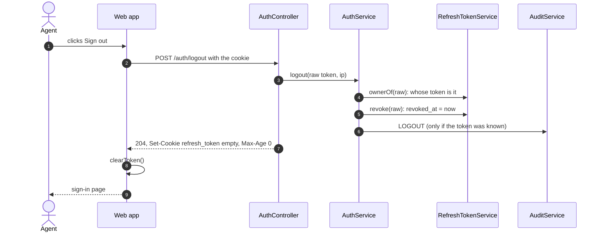
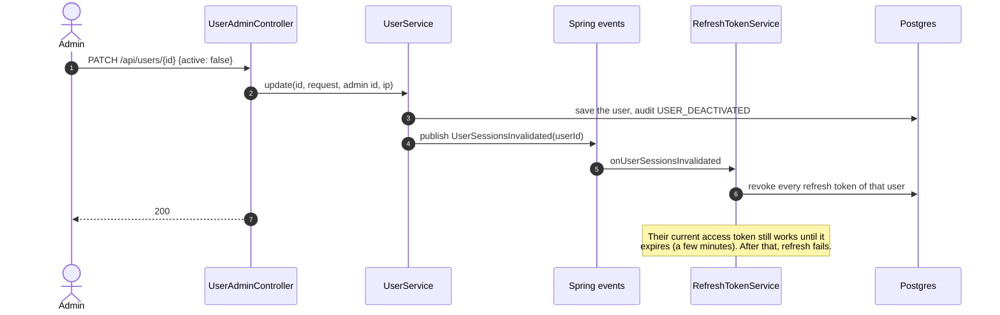

# 4.4 Page reload, logout and ending sessions

[← 4.3 Token refresh](03-token-refresh.md) · [Sequence list](README.md) · Next: [4.5 Signing keys →](05-signing-keys.md)

Three ways a session starts again or ends.

## Page reload: the session comes back from the cookie

The access token lived only in memory, so a reload loses it. The refresh cookie survives.

```mermaid
sequenceDiagram
    autonumber
    actor U as Agent
    participant AP as AuthProvider<br/>(AuthContext.tsx)
    participant CL as client.ts
    participant API as Backend

    U->>AP: reloads the page
    AP->>AP: state = checking (shows nothing yet)
    AP->>CL: refreshSession()
    CL->>API: POST /auth/refresh with the cookie
    alt cookie valid
        API-->>CL: 200 new access token + new cookie
        CL->>CL: setToken()
        AP->>API: GET /api/me
        API-->>AP: who I am, my role
        AP->>AP: state = signedIn
        AP-->>U: the page they were on
    else no cookie, expired or revoked
        API-->>CL: 401
        AP->>AP: state = signedOut
        AP-->>U: sign-in page
    end
```

## Logout

Logout never fails from the user's side: an unknown or missing token is ignored, and the web app clears its token whatever happens.

## An admin ends someone's sessions

When an admin deactivates a user, changes their password or changes their role, that user must log in again.

**The trade-off to know for interviews:** a JWT can't be "un-issued". Revoking refresh tokens stops new access tokens at once, but an access token already handed out stays valid until its `exp`. That's why access tokens are kept short-lived.
