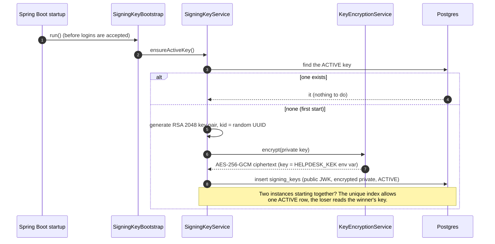
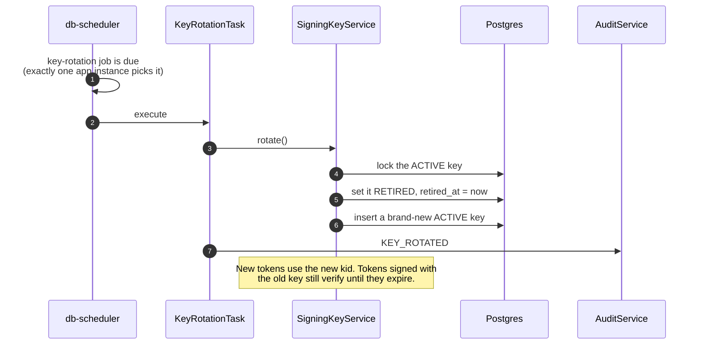
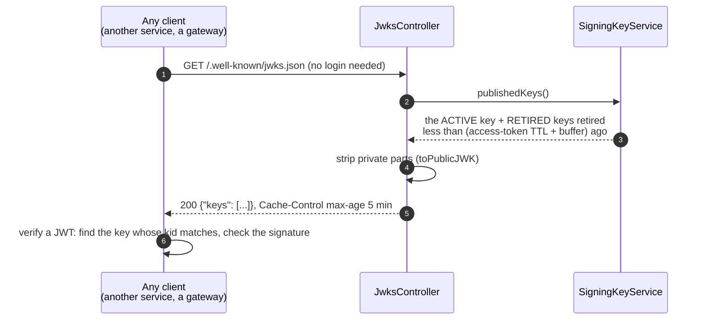

# 4.5 Signing keys: startup, rotation and JWKS

[← 4.4 Page reload and logout](04-reload-and-logout.md) · [Sequence list](README.md) · Next: [4.6 Inbound email →](06-inbound-email.md)

Every access token is signed with an RSA private key. This is where those keys come from, how they're replaced, and how anyone can get the public halves.

## At startup: make sure a key exists

## Every 7 days: rotation

## Anyone can fetch the public keys: JWKS

## What to notice

- **Why keep retired keys published for a while?** A token signed one minute before rotation is still valid for the rest of its lifetime. Its key must stay in JWKS until that token has expired, then it's dropped.
- **Private keys are never stored in clear.** They're encrypted with a key-encryption key (`HELPDESK_KEK`) that lives in an environment variable, not in the database. Stealing a database backup isn't enough to forge tokens.
- **The `kid`** (key ID) in each token's header is how a verifier knows which public key to use. That's what makes rotation possible without breaking existing tokens.
- **This is the same model OCI IAM and other identity providers use:** a JWKS URL, rotating keys, and `kid` selection.
