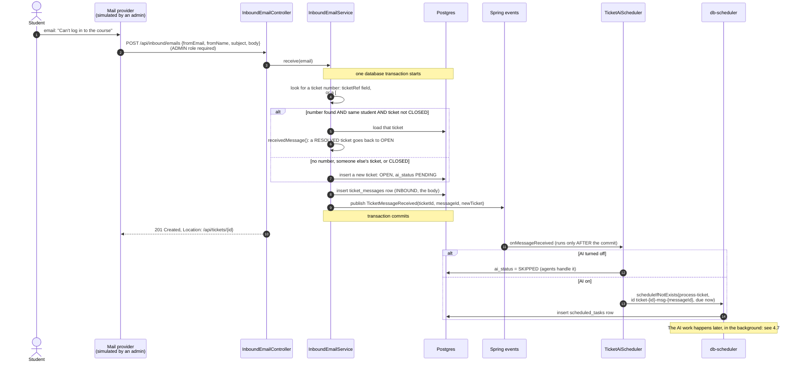

# 4.6 A student's email becomes a ticket

[← 4.5 Signing keys](05-signing-keys.md) · [Sequence list](README.md) · Next: [4.7 AI processing →](07-ai-processing.md)

A student emails support. Today an admin simulates the mail provider by posting the email to `POST /api/inbound/emails`; a real provider webhook would call the same service.

## What to notice

- **Threading needs two matches.** A reply joins an existing ticket only if the ticket number matches *and* the sender is that ticket's student. A student can't write into someone else's ticket just by guessing a number.
- **A CLOSED ticket is never reopened** by email; a new ticket starts instead.
- **The request returns fast.** Calling Claude takes seconds, so it isn't done inside the HTTP request. The request only stores the email and queues a job.
- **Why wait for the commit before queuing the AI job?** If the transaction rolled back, a job queued earlier would point at a ticket that doesn't exist. `@TransactionalEventListener(AFTER_COMMIT)` guarantees the ticket is saved first.
- **One job per message.** The job ID includes the message ID, and `scheduleIfNotExists` ignores duplicates, so the same event can't run the AI twice.
