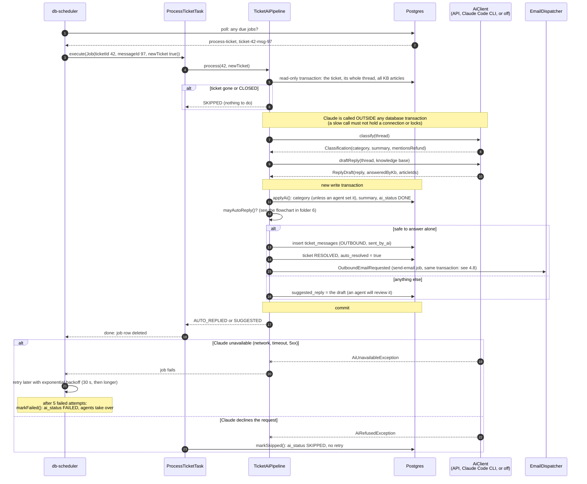

# 4.7 The AI processes the ticket

[← 4.6 Inbound email](06-inbound-email.md) · [Sequence list](README.md) · Next: [4.8 Agent reply and email →](08-agent-reply-and-email.md)

A background job, a moment after 4.6. No HTTP request is involved: db-scheduler finds the due job in the database and runs it.

## What to notice

- **Three AI modes, one interface.** `AiClient` has three implementations: `AnthropicAiClient` (Claude API), `ClaudeCodeAiClient` (runs the `claude` CLI locally, no API bill) and `DisabledAiClient`. `AiConfig` picks one from `helpdesk.ai.mode`. The pipeline doesn't know which one it's talking to.
- **Two models.** A small, fast model classifies (`claude-haiku-5-5`); a stronger one writes the reply (`claude-sonnet-5-5`).
- **The AI only answers from the knowledge base.** The draft must cite KB article IDs that really exist, or it isn't sent.
- **Auto-reply is the exception, not the rule.** Only a brand-new ticket with one message, unassigned, a general or technical question, no mention of refunds, and a KB-backed answer. Everything else becomes a suggestion an agent can edit.
- **Failures never lose the ticket.** It's already saved (4.6). The worst case is `FAILED` or `SKIPPED`, and an agent handles it as normal.
- **Retry vs give up.** A temporary problem (Claude down) is retried; a refusal isn't, because asking again would get the same answer.
