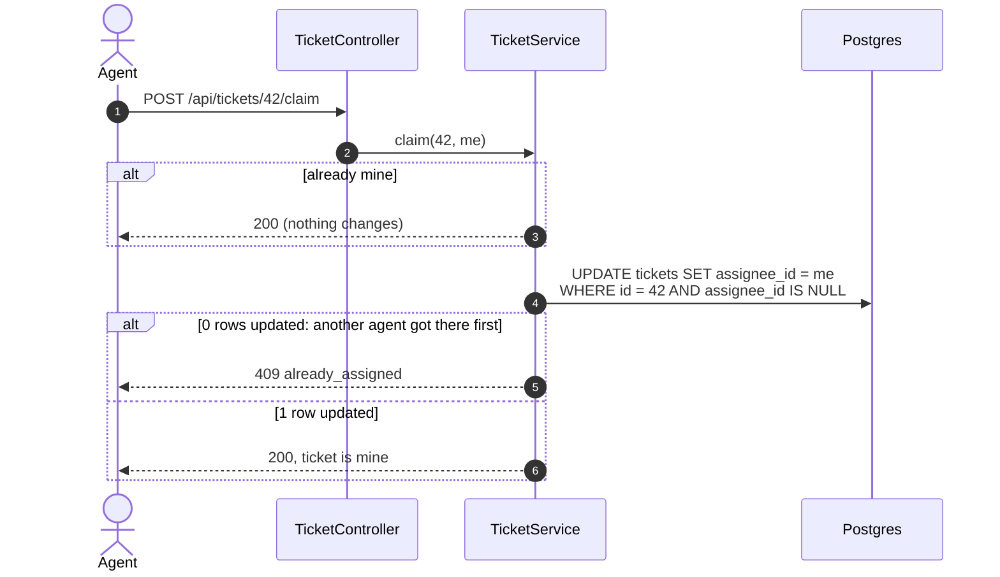
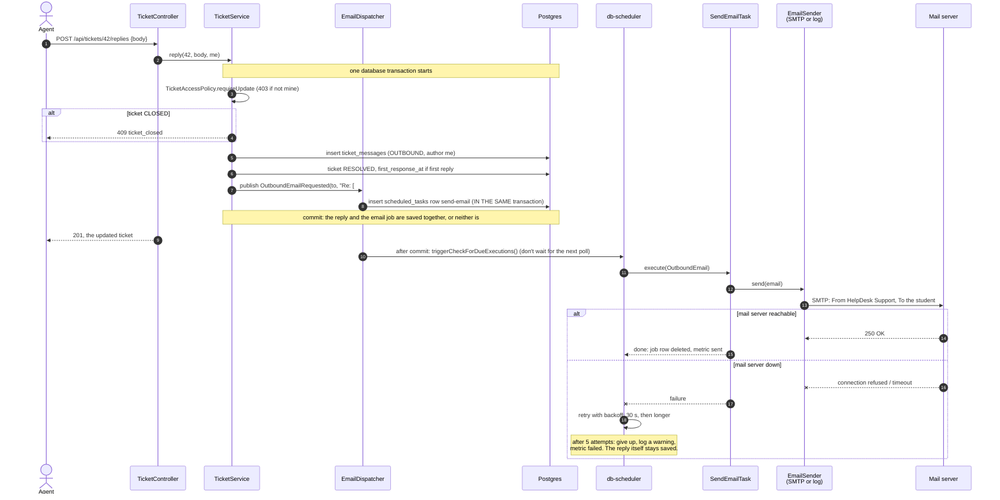

# 4.8 An agent claims and replies; the email goes out

[← 4.7 AI processing](07-ai-processing.md) · [Sequence list](README.md) · Next: [4.9 Auto-close →](09-auto-close.md)

## Claim: take a ticket from the shared queue

If two agents click Claim at the same moment, the database decides: the `WHERE assignee_id IS NULL` condition can be true for only one of them.

## Reply: the transactional outbox

## What to notice

- **The outbox pattern.** The email isn't sent inside the request. Instead, a "send this email" job is written to the database *in the same transaction* as the reply. If the reply rolls back, so does the job (no email for a reply that doesn't exist). If the reply commits, the job is guaranteed to exist (no reply without its email).
- **Why that's needed:** sending first and saving second can email the student about a reply that then fails to save. Saving first and sending second can lose the email if the app crashes between the two steps. The outbox avoids both.
- **"Re: [#42] subject"** puts the ticket number in the subject, so the student's answer threads back to ticket 42 (see 4.6).
- **Two senders:** `SmtpEmailSender` really sends (to Mailpit locally); `LoggingEmailSender` only logs. `helpdesk.email.mode` picks one.
- **The AI's automatic reply (4.7) uses exactly this path** from step 8 onward.
