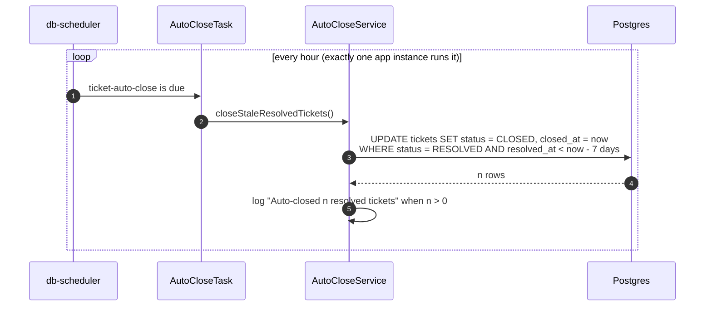

# 4.9 Auto-close

[← 4.8 Agent reply and email](08-agent-reply-and-email.md) · [Sequence list](README.md) · Next folder: [5. State machines →](../05-state-machines/README.md)

A resolved ticket the student hasn't answered for 7 days is closed automatically.

## What to notice

- **One SQL statement does the work.** There's no loop over tickets in Java; the database updates every matching row at once.
- **Only RESOLVED tickets close.** An OPEN ticket is waiting for staff, so it's never closed automatically.
- **Recurring jobs live in the database too.** Like `key-rotation`, `ticket-auto-close` is a row in `scheduled_tasks`, so with three app instances it still runs once an hour, not three times.
- **After this, the story of a ticket is complete:** email (4.6), AI (4.7), agent (4.8), closed (4.9). Folder 5 shows the same lifecycle as a state diagram.
