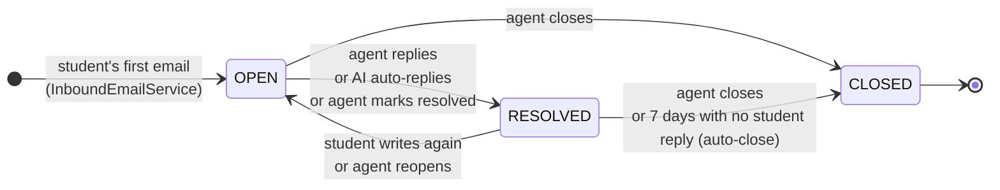
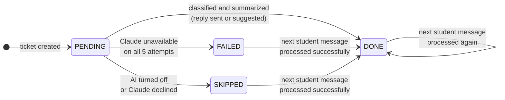
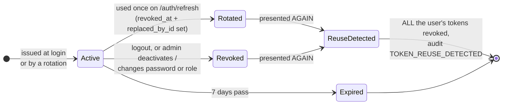
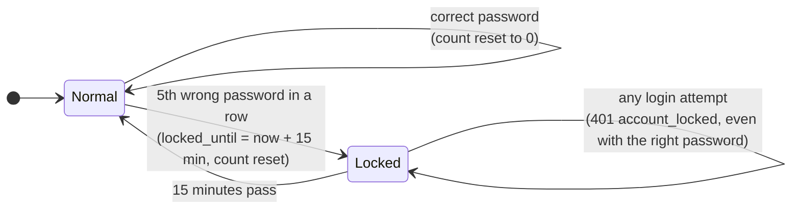
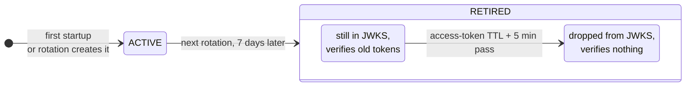
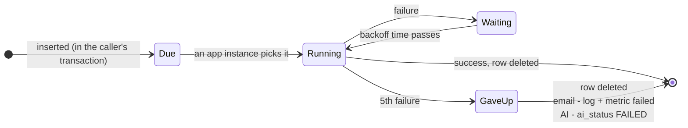
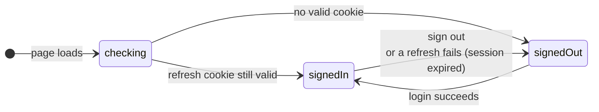

# 5. State machines: statuses and what changes them

[← 4. Sequence diagrams](../04-sequence-diagrams/README.md) · [All diagrams](../README.md) · Next: [6. Flowcharts →](../06-flowcharts/README.md)

Anything with a status column has rules about which status can follow which. The sequence diagrams showed these changes one flow at a time; here each lifecycle is in one picture. Most important first.

## 5.1 Ticket status (`TicketStatus`: OPEN, RESOLVED, CLOSED)

- **CLOSED is final.** Any status change on a closed ticket is refused (`409 invalid_transition`), and so is a reply (`409 ticket_closed`). An email about a closed ticket starts a new ticket.
- **A reply resolves.** Answering the student moves the ticket to RESOLVED: the ball is in the student's court. If they write back, it's OPEN again.
- Where in the code: `Ticket.receivedMessage`, `replied`, `resolve`, `reopen`, `close`, `autoResolve`; `TicketService.update`; `TicketRepository.closeResolvedBefore`.

## 5.2 AI status (`AiStatus`: PENDING, DONE, FAILED, SKIPPED)

A separate status from 5.1: where the AI is with this ticket.

- **The web app shows "AI is reading"** while a ticket is PENDING.
- **FAILED and SKIPPED aren't errors for the user.** The ticket simply goes to agents without an AI summary or draft.
- Every later student message queues a new AI job, so the status can change again. It never returns to PENDING.

## 5.3 Refresh token

Not a status column, but a lifecycle built from `revoked_at`, `replaced_by_id` and `expires_at`.

- **A token is good for exactly one refresh.** After that it's Rotated, and its successor is the only live one.
- **ReuseDetected isn't stored;** it's what happens at the moment an old token comes back. See [4.3](../04-sequence-diagrams/03-token-refresh.md).

## 5.4 Account lockout (`users.failed_login_count`, `users.locked_until`)

Lockout protects one account from password guessing. The rate limiter (20 tries a minute per IP, 5 per email) protects against floods. They're separate defences, checked in that order: rate limit first, then lockout.

## 5.5 Signing key (`KeyStatus`: ACTIVE, RETIRED)

- **Exactly one ACTIVE key**, enforced by a unique index in the database.
- The RETIRED key stays published just long enough for every token it signed to expire. See [4.5](../04-sequence-diagrams/05-signing-keys.md).

## 5.6 Background job (`scheduled_tasks` row: send-email, process-ticket)

## 5.7 Web app sign-in state (`AuthContext.tsx`)

The React app shows nothing while `checking`, the sign-in page when `signedOut`, and the ticket screens only when `signedIn`.
