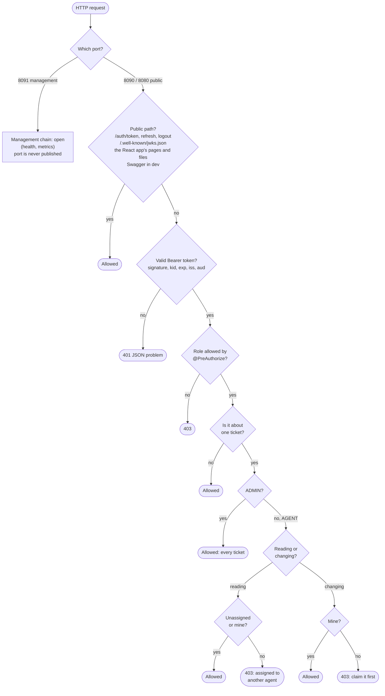
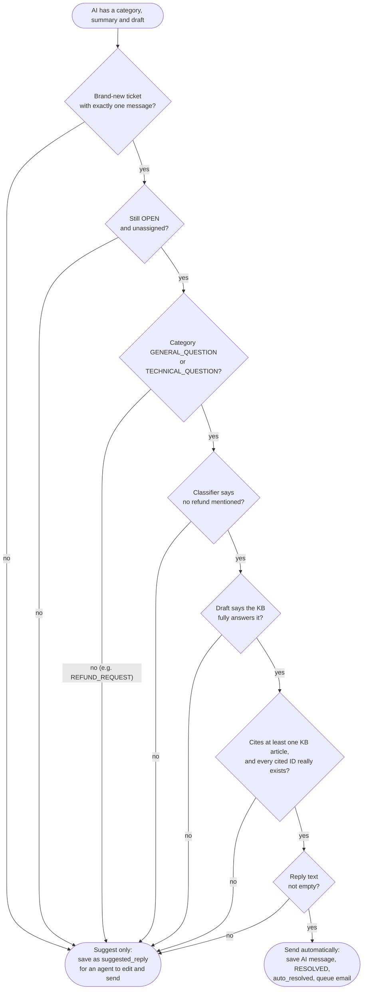
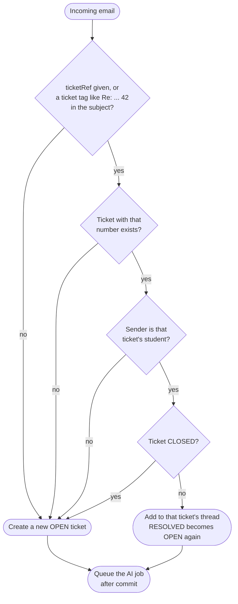
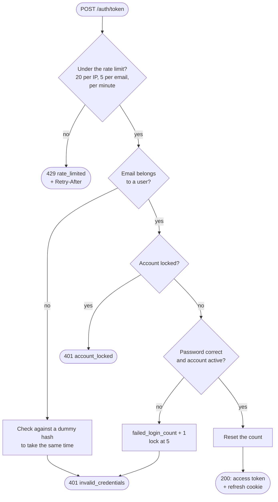

# 6. Flowcharts: how the tricky decisions are made

[← 5. State machines](../05-state-machines/README.md) · [All diagrams](../README.md) · Next: [7. Class diagram →](../07-class-diagram/README.md)

A sequence diagram shows *who* talks to *whom*. A flowchart zooms in on one decision and shows every branch. Most important first.

## 6.1 Who may do what with a request

Every HTTP request goes through these checks, in this order.

| Check | Where in the code |
|---|---|
| Which chain | `SecurityConfig`: `managementFilterChain` (order 1), `securityFilterChain` (order 2) |
| Token | `JwtDecoderConfig` |
| Role | `@PreAuthorize` on `TicketController`, `UserAdminController`, `InboundEmailController`, ... |
| This ticket | `TicketAccessPolicy` |

## 6.2 May the AI answer the student by itself?

`TicketAiPipeline.mayAutoReply`. **Every** condition must be true; one "no" means the draft is only suggested to an agent.

The design rule behind it: the AI may act alone only where a mistake is cheap. Money (refunds), follow-up conversations, and anything a person already owns always go to a human.

## 6.3 Does an incoming email start a new ticket?

`InboundEmailService.receive`.

## 6.4 The login checks

`AuthService.login`. The order is the point: the cheapest checks run first, and the slow password hash runs last.

Every outcome, success or failure, is written to `auth_events`.
