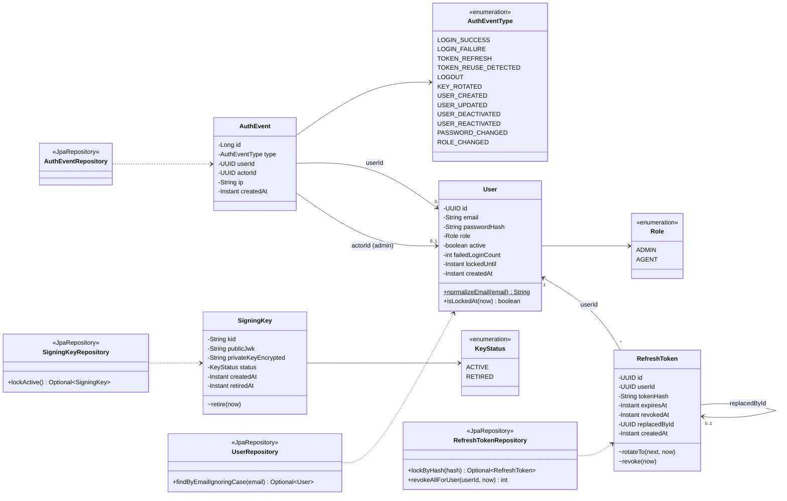
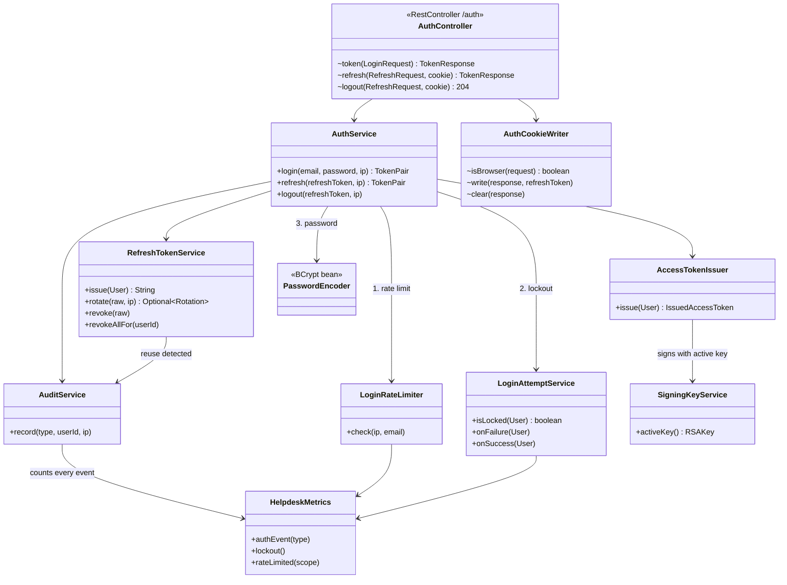
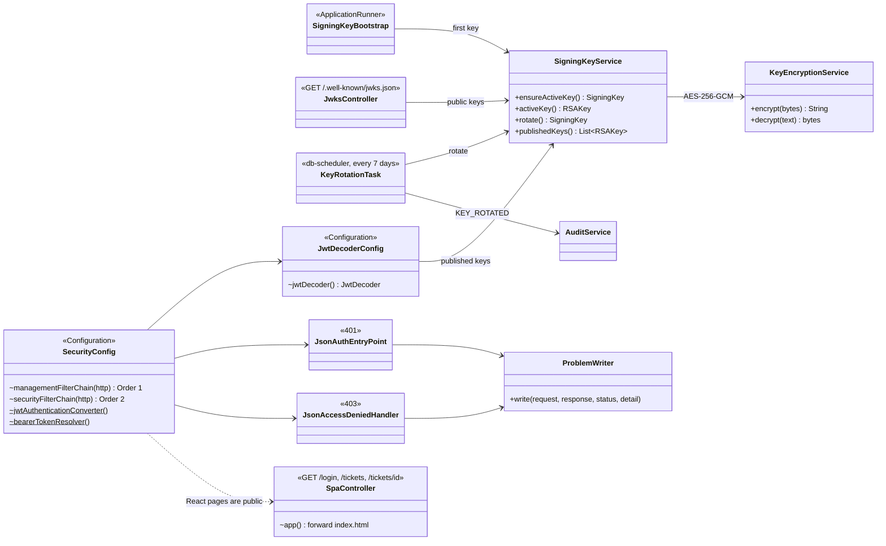
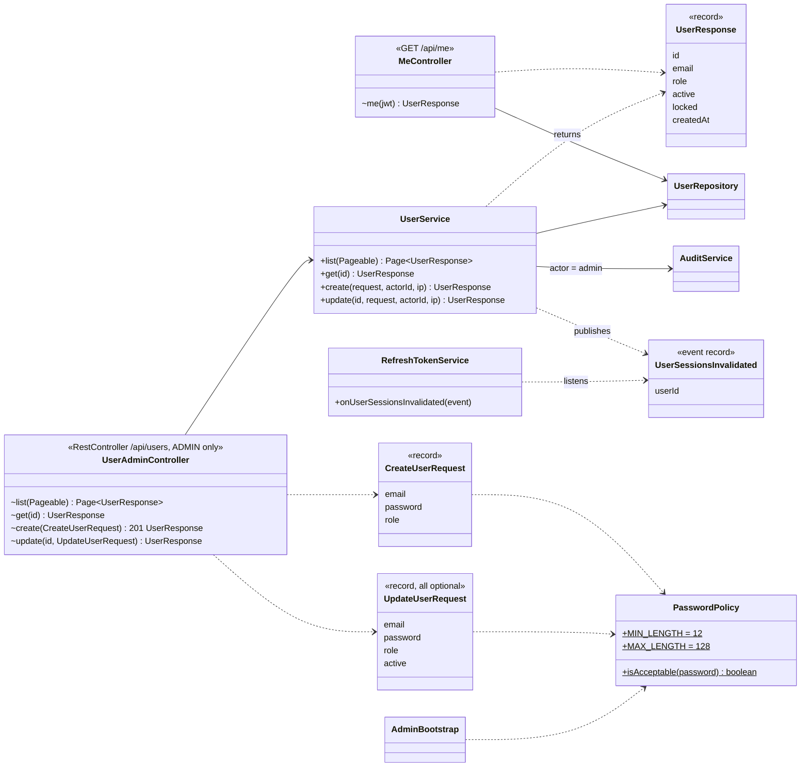
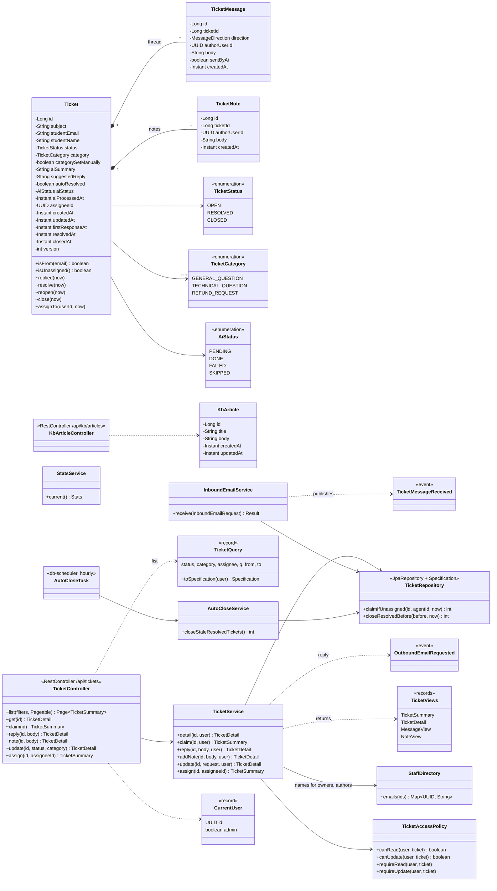
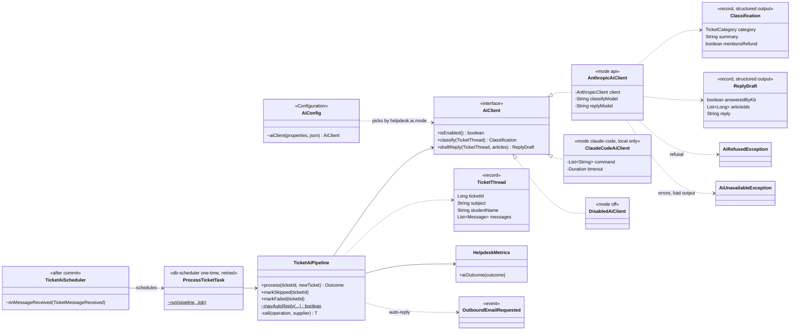
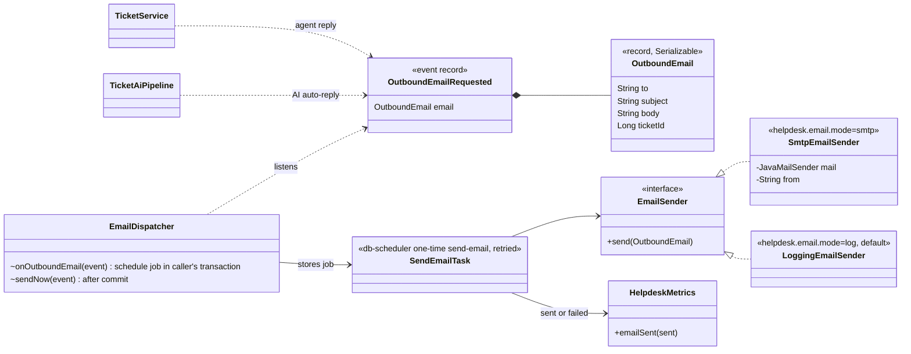
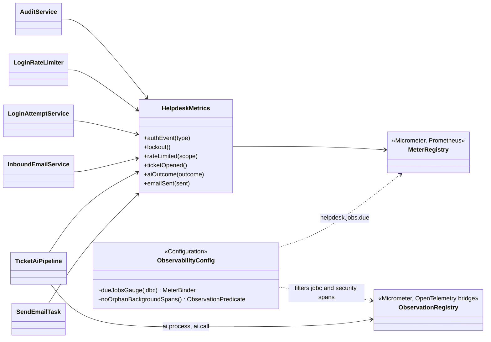
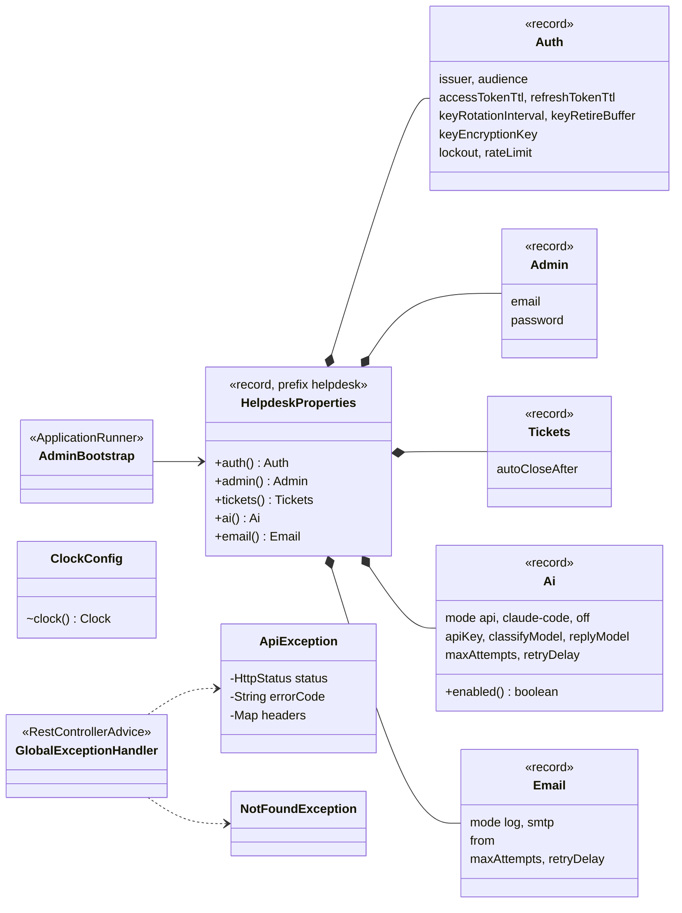
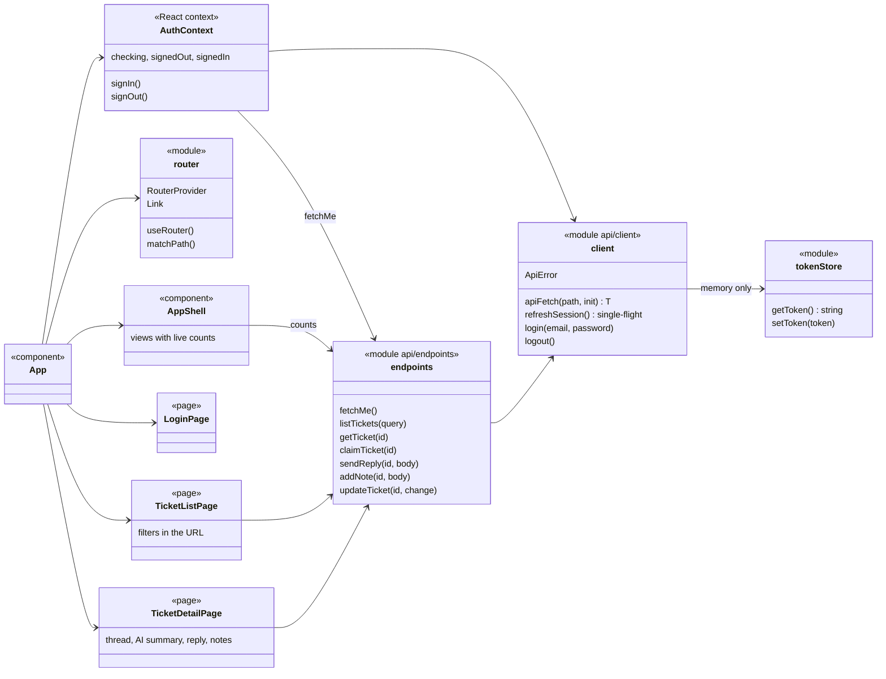

# 7. Class diagram

[← 6. Flowcharts](../06-flowcharts/README.md) · [All diagrams](../README.md)

Every class in `backend/src/main/java` as built (Phases 1–9), plus the web app's modules. GitHub draws the diagrams below.

**100** Java source files · **10** backend packages · **11** Flyway migrations · **182** backend tests · **10** frontend tests

## Packages

Code is split by feature, not by layer.

| Package | Job | Classes |
|---|---|---|
| `auth` | Login, refresh, logout, token checks, rate limits, lockout | AuthController, AuthService, AccessTokenIssuer, RefreshTokenService, RefreshToken, RefreshTokenRepository, LoginRateLimiter, LoginAttemptService, AuthCookieWriter, SecurityConfig, JwtDecoderConfig, JsonAuthEntryPoint, JsonAccessDeniedHandler |
| `keys` | RSA signing keys, encryption at rest, JWKS, rotation | SigningKey, KeyStatus, SigningKeyRepository, SigningKeyService, KeyEncryptionService, SigningKeyBootstrap, JwksController, KeyRotationTask |
| `user` | Accounts, the first admin, the admin user API, the signed-in user | User, Role, UserRepository, AdminBootstrap, PasswordConfig, PasswordPolicy, UserService, UserAdminController, MeController, CreateUserRequest, UpdateUserRequest, UserResponse, UserSessionsInvalidated |
| `audit` | Auth event log | AuthEvent, AuthEventType, AuthEventRepository, AuditService |
| `ticket` | Tickets, threads, the shared queue, stats, auto-close | Ticket, TicketMessage, TicketNote, TicketStatus, TicketCategory, AiStatus, MessageDirection, TicketRepository, TicketMessageRepository, TicketNoteRepository, TicketAccessPolicy, TicketService, TicketQuery, TicketController, TicketViews, TicketRequests, TicketLimits, StaffDirectory, InboundEmailService, InboundEmailController, InboundEmailRequest, TicketMessageReceived, StatsService, StatsController, AutoCloseService, AutoCloseTask |
| `kb` | Knowledge base articles | KbArticle, KbArticleRepository, KbArticleController |
| `ai` | Claude: classify, summarize, draft, auto-reply | AiClient, AnthropicAiClient, ClaudeCodeAiClient, DisabledAiClient, AiConfig, Classification, ReplyDraft, TicketThread, TicketAiPipeline, ProcessTicketTask, TicketAiScheduler, AiRefusedException, AiUnavailableException |
| `email` | Outgoing email through a transactional outbox | EmailSender, LoggingEmailSender, SmtpEmailSender, OutboundEmail, OutboundEmailRequested, EmailDispatcher, SendEmailTask |
| `common` | Errors, time, caller, metrics, tracing rules, the React routes | GlobalExceptionHandler, ApiException, NotFoundException, ProblemWriter, ClockConfig, CurrentUser, Emails, HelpdeskMetrics, ObservabilityConfig, SpaController |
| `config` | Typed settings, API docs | HelpdeskProperties, OpenApiConfig |
| `(root)` | Entry point | HelpdeskApplication |
| `frontend/src` | React app (TypeScript modules, not classes) | tokenStore, api/client, api/endpoints, api/types, AuthContext, router, AppShell, TicketBits, Toast, format, LoginPage, TicketListPage, TicketDetailPage, App |

## Accounts, keys, and audit tables

The JPA entities behind sign-in, one per table, and the repositories that read them. Relationships are foreign keys stored as UUIDs.

- `users.email` is stored lowercased; the database rejects anything else.
- `refresh_tokens.token_hash` is the SHA-256 of the token; the raw value is never stored. `lockByHash` takes a row lock, so two refreshes with the same token run one after the other.
- A partial unique index allows only one `ACTIVE` row in `signing_keys`.

## Login, refresh, and logout

What runs behind `POST /auth/token`, `/auth/refresh` and `/auth/logout`. Arrows point from the caller to what it uses.

- `AuthService.login` checks in that order, so a flood of guesses is stopped before the slow BCrypt check. Unknown email and wrong password give the same 401 `invalid_credentials`.
- `RefreshTokenService.rotate` returns empty instead of throwing for a bad token, so when it detects reuse the "revoke the whole family" update still commits.
- With `X-Auth-Client: browser`, `AuthCookieWriter` puts the refresh token in an HttpOnly, SameSite=Strict cookie on `/auth`, and the response body leaves it out.
- Every audit event is also counted in `helpdesk_auth_events_total{type}`, so the dashboard shows logins, refreshes and token reuse from one place.

## Signing keys, token checks, and the security chains

How keys are created, published and rotated, and how every request is checked. Two filter chains: an open one for actuator on the private management port, and the API chain.

- `publishedKeys` returns the ACTIVE key plus RETIRED keys retired less than 20 minutes ago (15 min token lifetime + 5 min buffer). JWKS and token checking use this one list, so a key that leaves JWKS can no longer verify anything.
- The JWT decoder checks the signature, `exp`, `iss` and `aud`, with 30 seconds of clock skew. The `roles` claim becomes `ROLE_ADMIN` or `ROLE_AGENT`.
- `managementFilterChain` matches actuator endpoints only, which live on port 8091; Docker never publishes that port. On the public port, `/actuator/**` doesn't exist.
- The React app's pages and files are public (they hold no data); everything it shows comes from `/api`, which needs a token.

## User management and the signed-in user

The admin-only API at `/api/users`, the `/api/me` endpoint the web app uses, and how a change ends a user's sessions without `user` depending on `auth`.

- Deactivating, a password change or a role change publishes `UserSessionsInvalidated`; the `auth` package revokes that user's refresh tokens in the same transaction.
- No delete: users are deactivated, so the audit trail keeps pointing at real accounts. An admin can't deactivate or demote themselves (409 `cannot_modify_self`).
- The access token carries only the user id and roles, so the web app asks `/api/me` for the email and role.

## Tickets, the knowledge base, and the queue

The ticket entities and the services that work them. Every ticket endpoint goes through `TicketAccessPolicy`.

- `TicketAccessPolicy`: admins read and change every ticket; agents read unassigned tickets and their own, and change only their own. Another agent's ticket is a 403.
- `claimIfUnassigned` is one conditional `UPDATE ... WHERE assignee_id IS NULL`: when two agents claim at once, one gets 0 rows and a 409 `already_assigned`. `@Version` turns any other lost update into a 409 `conflict`.
- `StaffDirectory` looks up agent emails for a whole page in one query, so the web app shows names instead of UUIDs.
- `InboundEmailService` continues a thread only when the `[#id]` reference matches and the sender is the ticket's student. A resolved ticket reopens; a closed one starts a new ticket.

## AI pipeline

How a stored student email becomes a category, a summary, and either an automatic reply or a draft for an agent.

- `mayAutoReply` answers by itself only when every check passes: general or technical question, no refund wording, answered by the knowledge base with real article ids, still unassigned, first message. Otherwise the draft becomes `suggestedReply`.
- Claude is called outside any database transaction; the results are applied in a new transaction on a freshly loaded ticket, so an agent's claim during the call is seen.
- `AiRefusedException` isn't retried (ticket SKIPPED, goes to an agent). `AiUnavailableException` is retried with backoff, then FAILED.
- Each run is one trace, `helpdesk.ai.process`, with `claude classify` and `claude draft_reply` spans (`helpdesk.ai.call` timer, tagged operation, mode, outcome) and its SQL nested inside.

## Email outbox

Replies to students, from agents and from the AI, become background jobs stored with the reply, then go out over SMTP.

- The job row is written through db-scheduler's transaction-aware DataSource, so it commits or rolls back with the reply: no email for a rolled-back reply, and no lost email for a saved one.
- A failed send (mail server down) is retried 5 times with growing delays, then counted as `helpdesk_emails_total{outcome="failed"}`. The reply stays on the ticket either way.
- Locally the SMTP server is Mailpit, which catches every email. `OutboundEmail.toString()` leaves the body out, so it never reaches the logs.

## Metrics and tracing

The app's own counters, the backlog gauge, and the rule that keeps background spans out of Tempo. Prometheus scrapes port 8091; traces go to Tempo over OTLP.

- Tags are a few fixed values (event type, outcome, scope), never a user id, email or ticket id, so metrics hold no personal data.
- SQL spans come from datasource-micrometer with query text only, never parameter values. `noOrphanBackgroundSpans` keeps SQL and security-filter spans only inside a real trace, so the scheduler's polling and Prometheus scrapes don't flood Tempo.
- Free from the libraries: HTTP, JVM, Hikari pool and `dbscheduler_task_*` metrics.

## Startup, settings, and errors

Shared pieces the other packages depend on.

- The app refuses to start if `HELPDESK_KEK` is missing or isn't 32 bytes. Secrets are redacted from `toString()`.
- Everything time-based reads the `Clock` bean; tests swap in a clock they can move forward.
- Errors are RFC 9457 problem+json with a stable `error` code (`invalid_credentials`, `account_locked`, `rate_limited`, `already_assigned`, `ticket_closed`, `conflict`, ...) plus headers such as `Retry-After`.

## Web app modules

The React app is TypeScript modules and components rather than classes; this shows what depends on what.

- The access token lives only in `tokenStore`, a module variable, never in localStorage or sessionStorage. The refresh token is the HttpOnly cookie.
- On a 401, `apiFetch` runs one shared refresh (parallel requests reuse the same promise, so the backend's reuse detection never fires), then retries once; if that fails, the app returns to sign in.
- `router` is a small History API router (`/login`, `/tickets`, `/tickets/:id`); the queue's filters live in the URL, so every view is linkable.
